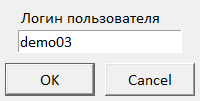
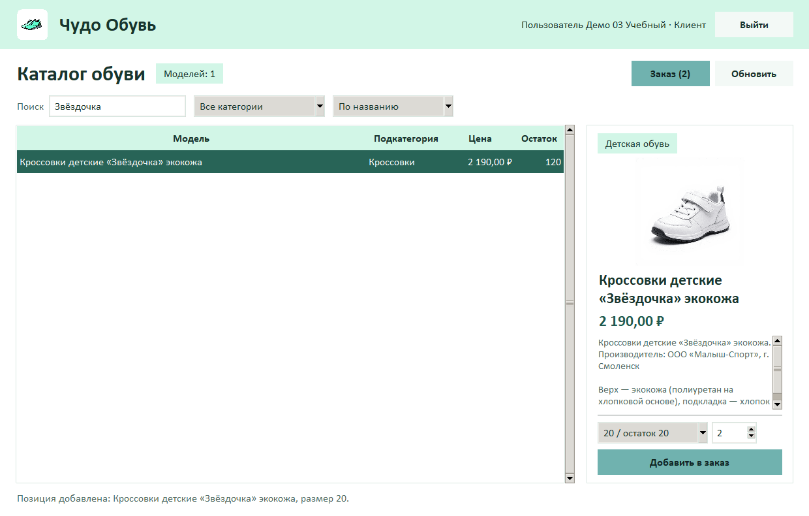
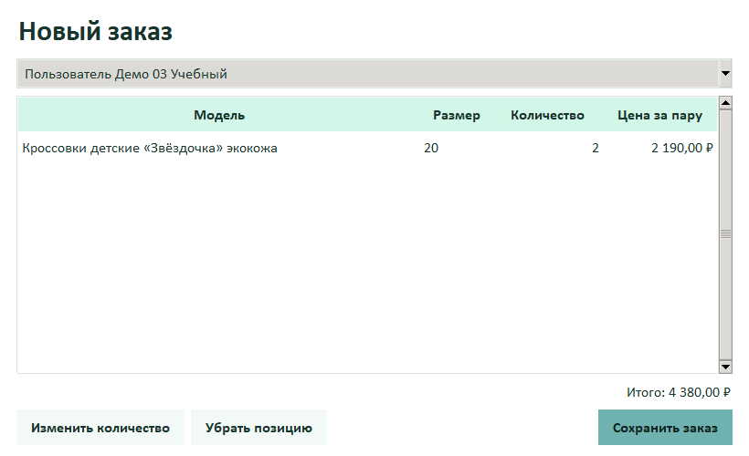
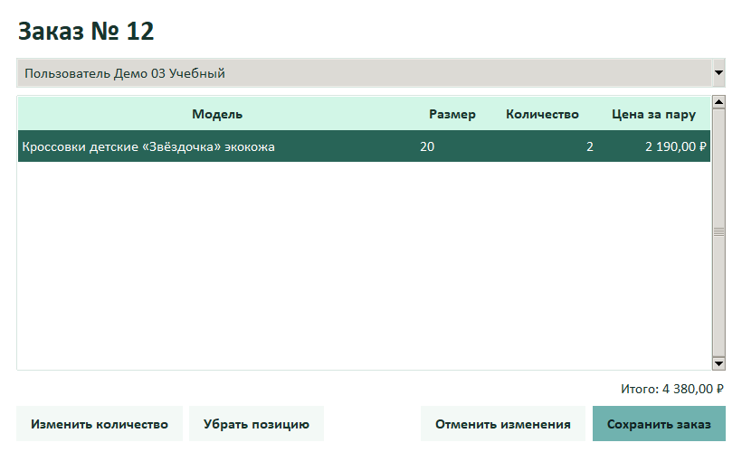

# Чудо Обувь

Учебное решение задания 1 демонстрационного экзамена 09.02.07-2-2027. Приложение на Python и Tkinter показывает каталог обуви, остатки по размерам и список заказов.

Импорт базы `chudo_obuv.sql` проверен в phpMyAdmin 5.2.1 на MySQL 9.3. Данные клиентов в открытой версии учебные.

[ER-диаграмма](ER.pdf)

## Каталог

## Вход

По условиям задания пользователи входят по логину из списка. Учётные записи заранее загружены в базу данных.

## Корзина

Клиент выбирает размер и количество, затем нажимает **Добавить в заказ**. Счётчик **Заказ (2)** показывает, сколько пар добавлено.

В черновике можно изменить количество, убрать позицию и сохранить заказ.

## Управление заказами

Администратор может открыть заказ, изменить его состав и сохранить изменения.

