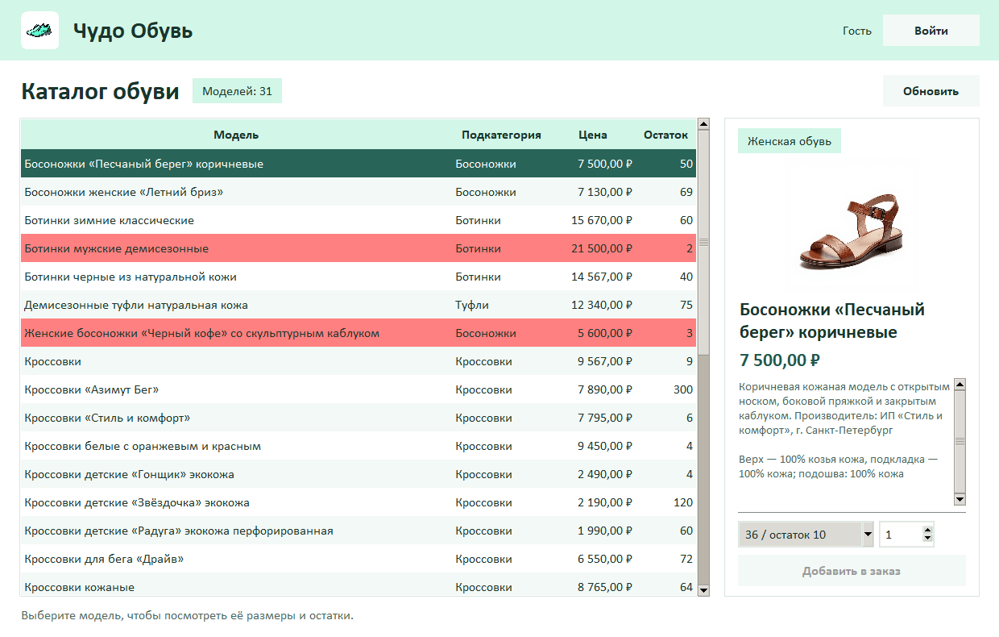
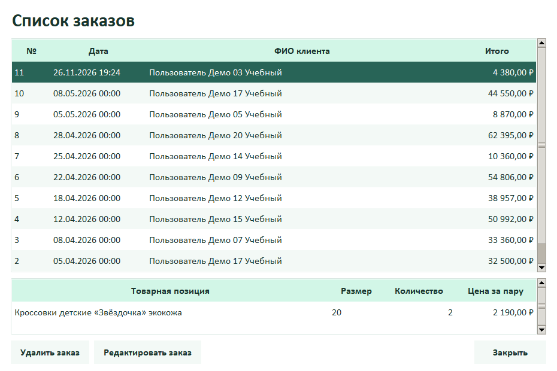

# Чудо Обувь

Учебное решение задания 1 демонстрационного экзамена 09.02.07-2-2027. Приложение на Python и Tkinter показывает каталог обуви, остатки по размерам и список заказов.

Импорт базы `chudo_obuv.sql` проверен в phpMyAdmin 5.2.1 на MySQL 9.3. Данные клиентов в открытой версии учебные.

[ER-диаграмма](ER.pdf) · [Отчёт по заданию](%D0%9E%D1%82%D1%87%D1%91%D1%82%20%D0%BF%D0%BE%20%D0%B7%D0%B0%D0%B4%D0%B0%D0%BD%D0%B8%D1%8E%201.docx)

## Каталог

## Заказы

